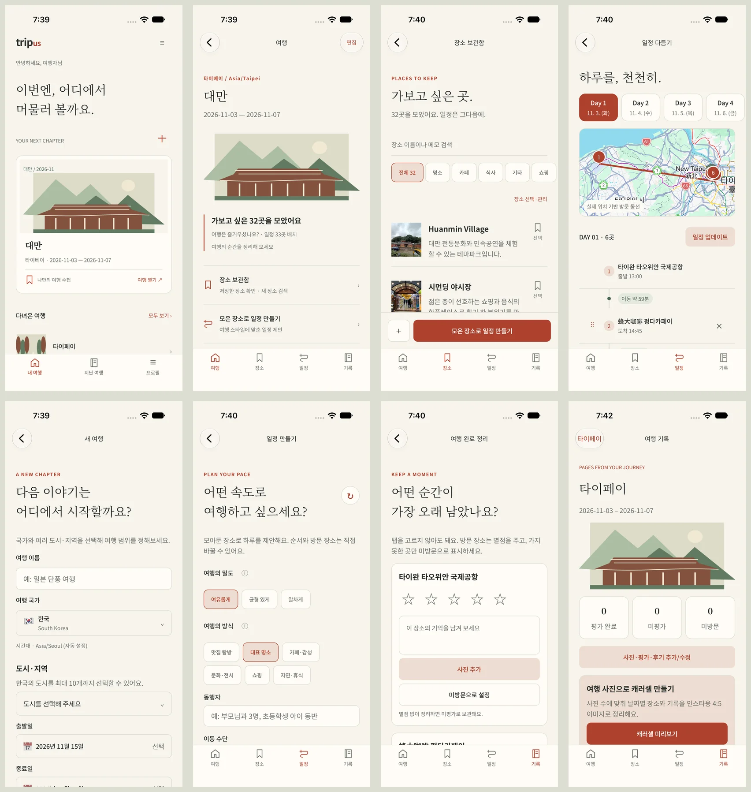

# TripUS · Field Notes

2026-11-15 확정. 디자인 기준은 [TripUS · 세 가지 디자인 방향 / 여행의 여백](https://www.figma.com/design/GmAwOgyaeo6s44x0pDcJbU?node-id=0-1)이다.

읽기 좋은 여행 수첩처럼, 장소를 모으고 하루를 다듬고 문장으로 여행을 남긴다. 모바일 전체 화면은 공통 토큰과 UI를 사용하며 로그인, 여행 목록·허브, 장소 검색·보관함, 새 여행·여행 수정, AI 생성·일정 편집, 방문 평가·기록, 프로필·Plus에 같은 스타일을 적용한다.

## 토큰

구현 기준: `apps/mobile/src/shared/design/tokens.ts`.

| 역할 | 값 |
| --- | --- |
| background / canvas | `#F7F4ED` |
| surface | `#FFFCF6` |
| text / ink | `#282C29` |
| muted | `#6B706A` |
| brand / primary | `#AD412D` |
| soft / primarySoft | `#EEDDD2` |
| border / line | `#DCDDD2` |
| support / secondary | `#4B6556` |

- 서체: Noto Serif KR(주요 제목), Noto Sans KR(본문·조작). Google Fonts 공식 배포본을 앱에 포함해 네트워크 없이 로드한다. 각 OFL 라이선스를 함께 보관한다.
- Display 28/44, Title 20/30, Body 15/24, Meta 12/20, Caption 11/18.
- 간격 4·8·12·16·24·32·48, 모서리 10·14·999.
- 기본 아이콘 20dp, 주 행동 버튼 50dp, 선택·평가 등 주요 터치 영역 최소 44dp.
- 밝은 바탕과 얇은 구분선, 벽돌색 선택 상태, 여백이 있는 문장형 제목을 사용한다. 선택은 색상 외 접근성 상태·문구로도 알린다.

## 화면과 탐색

- 내 여행: 인사와 문장형 제목, 전체를 눌러 여는 여행 카드, 새 여행 버튼, 실제 지난 여행의 일부 목록.
- 여행 허브: 여행 정보·원본 일러스트·현재 준비 상태를 먼저 표시하고, 장소 수집 → 일정 생성·수정 → 기록의 다음 행동을 행으로 연결한다.
- 여행 안: 여행·장소·일정·기록의 하단 탐색. 하단 탐색으로 이동할 때 저장하지 않은 일정·별점·메모가 있으면 계속 편집하거나 저장 여부를 결정할 수 있게 안내한다. 전체 앱의 내 여행·지난 여행·프로필 탐색은 유지한다.
- 장소 보관함: 실제 사진 중심의 목록, 저장 장소 이름·메모 검색, 분류 필터, 선택·일괄 제거 관리, 장소 추가와 일정 생성 버튼.
- 여행 생성·수정: 여행 기간을 한 달력에서 시작일~종료일 범위로 선택하고 명시적으로 적용한다. 두 경계 장소가 비었을 때 첫 선택 장소를 반대쪽에도 채운다.
- 일정: 날짜 선택, 실제 지도, 방문 순서와 이동 시간, 명시적인 변경 저장을 유지한다.
- 여행 기록: 장소별 방문 여부·별점·후기를 유지하고 별점 선택 상태와 터치 영역을 명확히 한다. 기록 보기는 세리프 제목과 원본 일러스트를 사용한다.

## 정적 시안과 실제 제품의 구분

Figma 보드는 변수 바인딩과 프로토타입 연결이 없는 정적 시안이다. 보드에서 확인한 명세를 코드 토큰으로 구현한다. 실제 국가·도시·시작/종료 지점·숙소·AI 생성 조건, 무료 사용 한도, API 검증·비동기 작업·명시적 일정 저장·개인 기록 정책은 서비스 기획서를 따른다.

- 서울·경복궁·예시 평점·예시 지도·작성자 이름은 실제 데이터로 하드코딩하지 않는다. 그림은 장식 에셋이며 실제 사진이나 지리 정보를 나타내지 않는다.
- 저장 장소 제거는 기존 확인 후 삭제 방식이다. 서버에 없는 북마크 즉시 삭제·되돌리기를 새로 약속하지 않는다.
- AI 생성은 기존 비동기 생성·저장 후 일정 편집 방식이다. 저장 전 서버에 반영되지 않는 초안이라는 문구를 사용하지 않는다.
- 기록의 방문/미방문과 평가 상태를 유지한다. 사진·평가·후기는 기존 API로 저장한다.
- 실제 AI 생성 화면은 밀도 선택을 제공하지 않는다. 정적 시안에 남아 있는 속도·밀도 선택은 구현하지 않고 여행 방식·동행자·이동 수단·예산·추가 요청을 구성한다.

## 에셋 출처

브라우저 Figma Export로 SVG를 내려받아 원본 도형 그룹을 PNG로 렌더링했다. `apps/mobile/assets/field-notes/README.md`에 그룹과 파일 대응을 기록한다. 디자인 보드 전체를 화면 이미지로 사용하지 않는다.

## 구현 검증 (2026-11-15)

- 모바일 TypeScript 검사와 Expo ESLint 검사 통과.
- Jest 25개 suite, 87개 테스트 통과. 저장 장소 검색·분류 조합, 일괄 관리 노출, 하단 탐색, 미저장 기록 보호를 포함한다.
- iPhone 18 Pro / iOS 27.0의 설치된 Development Build에서 Maestro로 여행 목록, 새 여행, 허브, 장소, 일정, 기록 작성, AI 설정, 지난 여행, 기록 읽기, 로그인 화면의 탐색·렌더링을 확인했다. 데이터 생성·삭제, AI 생성, 로그인 실행·계정 초기화는 수행하지 않았다.
- 원본 PNG 7개의 로컬 파일·크기·내용과 화면에서의 일러스트·아이콘 배치를 확인했다. 실제 장소 사진과 지도는 기존 API 데이터로 렌더링한다.
- Android 실기기/에뮬레이터 검증은 수행하지 않았다. 네이티브 스플래시 배경 변경은 다음 네이티브 빌드에 반영된다.

